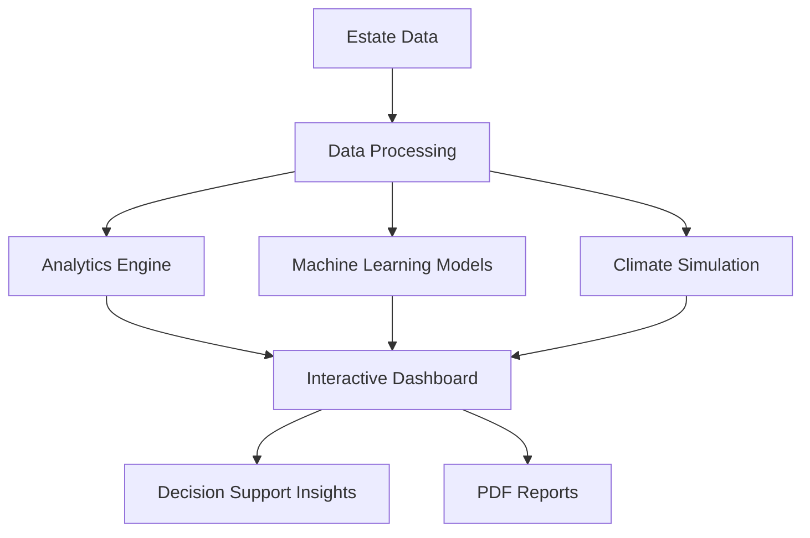

# EstateInsight
### AI-Powered Decision Support System for Coffee Estates

EstateInsight is a data-driven analytics and decision-support platform designed to help coffee estate stakeholders understand operational performance, explore agricultural data, monitor environmental conditions, and make informed decisions through interactive analytics and machine-learning-assisted insights.

The platform brings estate-related data, analytics, forecasting, environmental simulations, and decision-support recommendations together in an interactive dashboard.

---

## Overview

Coffee estate management involves multiple operational variables, including production, inventory, environmental conditions, revenue, and plantation health. EstateInsight aims to simplify the analysis of these variables through an interactive digital platform.

By combining data analytics, machine learning, visualization, and simulation capabilities, EstateInsight transforms structured agricultural and operational data into insights that can support planning and management.

## Key Features

- **Revenue Analytics** — Explore financial and revenue-related performance through interactive analytics.
- **Inventory Management** — Monitor and analyze inventory-related information.
- **Harvest Forecasting** — Apply machine-learning-based forecasting to explore potential harvest trends.
- **Climate Simulation Engine** — Simulate environmental scenarios using configurable climate parameters.
- **Estate Health Index** — Present an aggregated indicator of estate-related conditions.
- **AI Recommendation Engine** — Generate analytical recommendations to support decision-making.
- **Interactive Geographic Visualization** — Explore estate-related geographical information.
- **PDF Report Generation** — Export analytical reports for documentation and review.
- **Operational Analytics Dashboard** — Access key operational metrics through an interactive dashboard.

---

## System Architecture

The application follows a modular analytics workflow:



## Technology Stack

| Technology | Purpose |
|---|---|
| Python | Core application and analytical logic |
| Streamlit | Interactive web application interface |
| Pandas | Data processing and manipulation |
| Plotly | Interactive visualizations |
| Scikit-learn | Machine learning and predictive analytics |
| ReportLab | PDF report generation |

---

## Analytics & Intelligence Modules

### 1. Revenue Analytics
Analyze financial and revenue-related data to understand business performance and identify patterns in available operational records.

### 2. Harvest Forecasting
Utilize machine-learning-based forecasting to explore potential production trends and support planning.

### 3. Climate Simulation
Explore the potential influence of changing environmental parameters through configurable simulation scenarios.

### 4. Estate Health Index
Provide an aggregated analytical view of estate-related indicators to support monitoring and interpretation.

### 5. AI Recommendation Engine
Translate analytical observations into actionable suggestions intended to support operational decision-making.

### 6. Inventory Analytics
Monitor inventory-related information and support better visibility into available resources.

### 7. Geographic Analytics
Visualize estate-related geographical data to explore spatial patterns and location-based information.

### 8. Report Generation
Generate PDF reports to facilitate documentation, analysis and presentation of insights.

---

## Project Workflow

1. **Data Collection** — Load structured estate and operational datasets.
2. **Data Processing** — Organize, process and prepare data for analytical workflows.
3. **Exploratory Analytics** — Identify patterns, trends and relationships within available data.
4. **Model Development** — Apply machine-learning techniques for predictive analytics.
5. **Simulation** — Explore environmental scenarios using configurable parameters.
6. **Visualization** — Present analytical outputs using interactive dashboard components.
7. **Decision Support** — Provide insights and recommendations derived from analytical outputs.
8. **Reporting** — Generate downloadable reports for further reference.

---

## Installation & Setup

### Prerequisites

- Python 3.9+
- Git
- pip

### Clone the repository

```bash
git clone https://github.com/Nithyashree04/EstateInsight.git
cd EstateInsight
```

### Create a virtual environment

**Windows:**

```bash
python -m venv venv
venv\Scripts\activate
```

**Linux / macOS:**

```bash
python3 -m venv venv
source venv/bin/activate
```

### Install dependencies

```bash
pip install -r requirements.txt
```

### Run the application

```bash
streamlit run app.py
```

The application will open in your browser, typically at:

`http://localhost:8501`

---

## Project Structure

```text
EstateInsight/
│
├── app.py
├── data/
│   └── estate_data.csv
├── requirements.txt
├── README.md
└── ...
```

*The structure above represents a simplified example. The actual directory structure may differ depending on the project implementation.*

---

## Project Objectives

- Simplify the analysis of coffee estate operational data.
- Support data-driven decision-making.
- Explore the application of machine learning in agricultural analytics.
- Provide interactive environmental simulation capabilities.
- Improve the accessibility of estate-related analytics.
- Integrate analytics, visualization and reporting into a unified platform.

---

## Future Enhancements

- Integration with real-time IoT sensor data.
- Weather API integration.
- Advanced yield prediction models.
- Soil nutrient and crop health analytics.
- Pest and disease risk analysis.
- Mobile-friendly application experience.
- Estate-specific user accounts and data management.
- Advanced model evaluation and explainability.
- Cloud-based database integration.

---

## Limitations

EstateInsight is a decision-support and analytical platform. Forecasts, simulations and recommendations are dependent on the available dataset, underlying analytical methods and assumptions.

The outputs should be interpreted as analytical support rather than guaranteed agricultural, financial or operational outcomes.

---

## Project Information

**Project Name:** EstateInsight  
**Project Category:** AI / Machine Learning / Agricultural Analytics  
**Domain:** Smart Agriculture & Decision Support Systems  
**Application Framework:** Streamlit  
**Language:** Python

---

## Author

Developed as a technology-driven project exploring the integration of data analytics, machine learning and interactive decision-support tools within coffee estate management.

---

*EstateInsight — Turning Estate Data into Meaningful Insights.*
